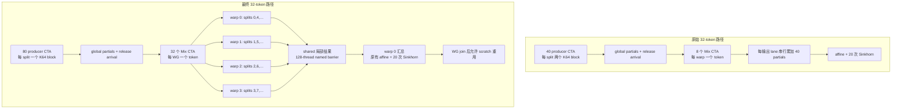
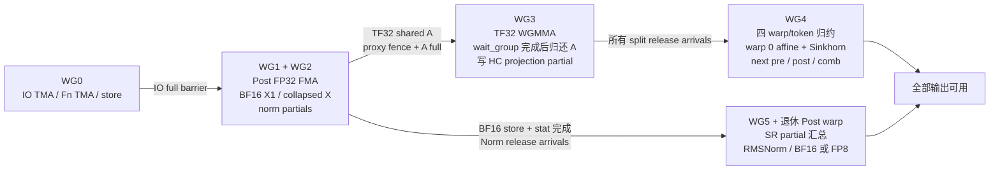

# H200 MegaMHC：32-token decode 优化

32-token shifted MegaMHC 的正式 boundary latency 从原始 V1 的 **16.388 µs 降到 11.790 µs，降低 28.06%**；同轮 SGLang 为 **17.537 µs**，加速约 **1.487×**。最终保留两项相互配合的改动：四 warp 协作完成每个 token 的 Mix 汇总，以及将 producer 从 40 splits 增至 80 splits。4096-token prefill 维持约 147 µs。

实现 commit：`a621931`，分支 `codex/sm90-megamhc`。测试使用的 production_v3 源码已按文件 hash 与该实现核对。

## 计时口径与累计阶段

设备为 `workflow_62960518` 的 GPU 1，H200、132 SM。使用 csy 环境、H=5120、hc=4、Sinkhorn=20，V4.1-Flash 第 0 层 FFN 的真实 mHC/Norm 权重与固定激活 fixture。所有阶段使用同一份此前冻结的输入，SHA256 保存在每次结果中。SGLang 的实际四份源码 SHA256 也记录在结果中，不能只用 HEAD 代表工作目录内容。

独立进程顺序为 **A B C D D C B A**。每个进程测 4096/32 两种 shape，每 graph 调用 64 次、24 轮 CUDA Event 计时；每个阶段合并 48 个 samples 取 median。MegaMHC 包含 barrier clear；SGLang baseline 使用当前 post、mix_stats、combine dispatcher，decode stats side stream 在 boundary 末 join。所有输出对照 SGLang、原始 fixture 期望值及独立 FP32 参考。

| 累计阶段 | 4096 tokens µs | 32 tokens µs | 本阶段实际改变 |
|---|---:|---:|---|
| 00 baseline：原始 MegaMHC V1 | 152.2580 | 16.3878 | 原始 SM90 路径 |
| 01 prefill opt1 | 146.8527 | 16.5618 | prefill split 目标下限 16→4 |
| 02 decode opt1 | 146.9370 | 15.3097 | 小 batch Mix：一个 WG/token，四 warp 并行归约 |
| 03 decode opt2 | 146.9870 | **11.7900** | 在 02 基础上允许 80 个 producer splits |

01 与 00 的 decode 算法、launch 相同，16.39/16.56 µs 的差异视为运行波动；02/03 的 prefill 路径也相同，不把表中小差异当作收益。最终 32-token 相对原始 V1 降低 28.06%；03 相对 02 再降低约 22.99%。同轮最终版本的 SGLang 为 4096 tokens 205.3235 µs、32 tokens 17.5375 µs。

这是单卡算子 boundary 实验，不包含 MoE、CP、跨 GPU collective 或整模型服务。decode stats 与后续子层的整层 overlap 也没有在这个最小用例中测量。下文热 fixture 的原型计时采用不同 harness，不能直接与本表相减。

## 为什么先改 Mix，再增加 splits

旧实现的 producer 只占 40 个 CTA，每 CTA 连续处理两个 K64 block。WG4 每个 warp 负责一个 token：32 tokens 仅占 8 个 CTA，各输出 lane 串行加载并累加 40 份 GEMM partial。producer 完成后，Mix 的跨 split 汇总仍在延长尾部。直接把 splits 加倍，会同时加倍这个串行汇总长度。

新实现用一个 WG 负责一个 token，将 40/80 份 partial 按 `split = 4 × round + warp` 分给四个 warp。每 warp 的输出 lane 累加自己的 24 个 HC 输出；四 warp 的局部结果放入 512 B shared scratch，经 named barrier 后由 warp 0 汇总并执行原来的 affine 与 20 次 Sinkhorn。32 tokens 现在使用 32 个 Mix CTA、128 个 Mix warp。



隔离热 fixture 的对照验证了两项改动的依赖关系：

| 原型 | 32 tokens µs（两次独立进程） | 解释 |
|---|---:|---|
| 当前 prefill opt1 | 15.707 / 15.708 | decode 原始路径 |
| 仅四 warp Mix | 14.634 / 14.624 | 汇总并行化，约降低 6.9% |
| 仅 split80 | 17.251 / 17.252 | 串行 Mix 加倍，反而变慢 |
| split80 + 四 warp Mix | 11.288 / 11.292 | producer 更短，同时控制汇总尾部 |

80 splits 让 80 个 producer CTA 各处理一个 K64 block，缩短 Post/TMA/WGMMA 这条 producer 链。GEMM 数学工作量与 M64 tile 不变；partial/stat workspace 从约 260 KiB 增至 520 KiB，跨 CTA arrivals 增多，收益来自更高并行度与更短任务，而非减少总计算或 workspace 流量。

## 最终架构与同步

grid 仍为 132 CTA，每 CTA 768 threads、6 个 WG；IO/Fn/A stage 深度保持 3/2/4，dynamic shared 保持 **220160 B**。



WG4 的三个 named barrier 分别传播 warp 0 的 producer acquire、发布 shared partial、保护下一 token 重用 scratch。logical barrier 5 与 shifted Norm worker 使用的 barrier 不重叠；Normal 路径不使用该 Mix scratch。512 B scratch 放入原有 normal scratch 与 1024 B 对齐 A 之间的 padding，未增加 shared allocation。

host 仅在 **SM90、shifted、16≤tokens≤64、非 deterministic** 时允许 split cap 128。H5120 的 80 个 K64 blocks 因而选择 80 splits。其他路径保留 cap64；deterministic 固定 16 splits 并保留原串行 Mix 汇总顺序。SM100 的 cap64、barrier tag stride128 保持原设计；SM90 的 tag stride 扩为256，容纳更大的 arrival count，防止与相邻 grid tag 混淆。

真正的关键路径是 producer 就绪后 Mix 分支与 Norm 分支的最大完成时间；不能只看总 warp 等待或一条热点指令。新 trace 将 Mix dependency/reduction/affine/Sinkhorn、Norm dependency/compute/store、Post IO/A wait、WGMMA Fn/A wait 分开记录；Tracing 关闭时 callback 编译消除。

同一套打点配方的 32-token 结果提供以下约束。表中的时间包含打点开销，不能替代开头的不打点 latency；Mix interval 的参与 warp 数也从 32 增至 128。

| 打点阶段 | V1 | decode opt1 | decode opt2 |
|---|---:|---:|---:|
| projection task interval median µs | 12.288 | 12.224 | 7.936 |
| projection 最晚完成 µs | 13.536 | 13.280 | 10.592 |
| Mix partial reduction interval median µs | 4.416 | 0.864 | 2.208 |
| Mix affine/Sinkhorn 最晚完成 µs | 21.280 | 17.664 | 16.448 |

先并行归约显著缩短 Mix；随后 split80 缩短 producer，却也增加 partial 汇总成本。因此要对照整个 boundary，而不能只要求每一项 interval 都下降。最终 capture 的 Norm 最晚到 17.280 µs，说明继续只优化 Mix 也会遇到另一分支的约束。八份 NCU 的 launch 均为132×768，dynamic shared=220160 B，local load/store sectors 均为0。

## 未采用的优化及后续处理

| 实验 | 热 fixture 结果 | 原因与处理 |
|---|---|---|
| 精确检测 Sinkhorn 长度 1/2 的 bitwise cycle | 11.288→11.874 µs，慢约 5.2% | 不改 eps、不做近似；只有整个 4×4 状态重复才跳过周期。当前输入五项输出 SHA 与固定 20 次一致，但检测需要状态保存、比较与 warp vote。继续降低检测频率验证成本。 |
| 每 4 次才检查 Sinkhorn cycle | 11.294→11.698 µs，仍慢约 3.6% | 稀疏检查减少检测开销，仍无总收益；不合入。实际执行轮次与阶段时间见归档中的诊断 trace。 |
| Norm SR partial 从 2 lanes/token 改为 16 lanes/token | 11.351→11.253 µs，降低约 0.9% | 提升统计归约并行度，收益不足 1%，不增加默认路径复杂度；诊断 trace 用于观察分支尾部变化。 |

实际打点确认：cycle 原型的 **32 个 token 全部仍执行 20 次**，该输入没有提前退出；affine/Sinkhorn 的 interval median 为 2.848 µs，最终固定迭代版本为 2.368 µs。检测在这里只增加开销，稀疏检查虽减轻回退，却没有产生可跳过的迭代。精确“状态重复”比数值上接近收敛严格得多，不能据此减少默认迭代数。

Norm16 的诊断 capture 中，Norm 分支最晚结束为 12.416 µs，而 Mix affine/Sinkhorn 到 15.552 µs 才结束；优化 Norm 后另一分支仍需完成。不同打点 launch 的 producer/CTA 时序也有变化，不能将两个独立 capture 的末端时间差直接解释为可回收的正式 latency；是否采用以不打点 ABBA 的不足 1% 净收益为准。最终代码保持原 Norm 与固定 20 次 Sinkhorn。

前一轮的双 outstanding atom、SIMT projection、stage 重分配等失败与修正记录见 [此前实验报告](sm90-mega-mhc-optimization-20261121.md)，本轮没有把这些无稳定收益的原型重新合入。

## 剩余 decode 方向的优先级

下一步应先评估 **producer 与两条 epilogue 分支的共同尾部**，而非继续减少很短的 WGMMA completion gate。对 H5120/T32，当前 80 splits 已是一份 K64 block/split，不能再用切分完整 K64 的办法缩短单 task；更多 split 会要求改 atom 粒度及布局。

较大的结构性候选是 decode 专用的 X1 保留与就地 Norm：在 producer 完成后保留本 CTA 的 collapsed tile，等完整 norm statistics 就绪后就地归一化，减少 X1 回读及通用 Norm 任务分发。需要重新设计 shared/register 生命周期、归约与所有 producer 的驻留条件；现有 shared 已占 220160 B，不能直接增加一个完整 ring。当前 Norm16 的不足 1% 净收益也说明“仅加速统计求和”不等于这项完整设计的收益。此候选本轮未实现，没有预设性能数字。

另一候选是减少 M64 在 T32 下的 padding，并保留 Tensor Core projection 与 Fn 跨 token 复用。Hopper WGMMA 的 M64 几何不能简单改成 M32，需要另选 MMA tile 与 warp ownership，再重排 Post/TMA/A pipeline。此前完整 SIMT projection 与分片补救仍慢于原实现，所以不再沿用纯 FP32 CUDA-core 投影路线。

轮询微调、四 warp 协作每一次 Sinkhorn 行列归一化、再次增加 outstanding atom 均排在后面：现有实验未显示可观净收益，引入的同步或 A 生命周期延长可能抵消指令减少。本轮已保留两项稳定的大收益改动，停止这些低收益微调。

## 回归与 profile 入口

最终 production_v3 通过九组回归，包括 Normal/shifted、tail、BF16/FP8 与 SF、one-hot projection、32-token graph 变输入并发 replay、64-token/32-SM 下同一 Mix WG 重用 scratch、deterministic 的重复运行及跨 batch/grid bitwise 一致性；另通过 4-SM、T129/T4096、Normal/shifted 多波回归。SM100 的 BF16 与 BF16+FP8 实例通过显式 `compute_100a → sm_100a` 编译，均为 80 registers、零 spill；没有 SM100 runtime 设备验证。

本地归档与累计对比目录：

```text
~/LLMInfer/profile/ncu/
  sm90-megamhc-decode-20261122/       # 完整原始证据，校验清单
  sm90-megamhc-stages/
    00_baseline_v1/{prefill_4096,decode_32}/
    01_prefill_opt1_split4/{prefill_4096,decode_32}/
    02_decode_opt1_parallel_mix/{prefill_4096,decode_32}/
    03_decode_opt2_split80/{prefill_4096,decode_32}/
    index.html                       # 选择阶段，比较内部时间线
    comparison.json
```

以前三份原始 profile 目录继续保留。每个累计阶段都提供独立 `%globaltimer` JSON、相同配方 NCU report、raw CSV、输入与源码 hash；打点时间不替代正式 latency。远端目录为 `/mnt/a6intlalipayplus-idt2-aidc/common/alipayplus/infer/xiaoyuan/experiments/sm90-megamhc-decode-20261122`。完整归档 310 份文件已在本地逐项通过 SHA256 校验，精简 Git 证据见 [归档索引](../../artifacts/sm90-mega-mhc-20261122/README.md)。

构建、最小 SGLang 对照与打点开关仍使用 [bench_sm90_megamhc.py](../../scripts/bench_sm90_megamhc.py) 顶部的命令。生成离线累计索引：

```bash
python scripts/compare_sm90_mhc_profiles.py \
  --input ~/LLMInfer/profile/ncu/sm90-megamhc-decode-20261122 \
  --output ~/LLMInfer/profile/ncu/sm90-megamhc-stages
```

SGLang 的调用接口不变，沿用现有 SM90 MegaMHC 接入方案；本轮修改的是 DeepGEMM 内部调度与归约。
