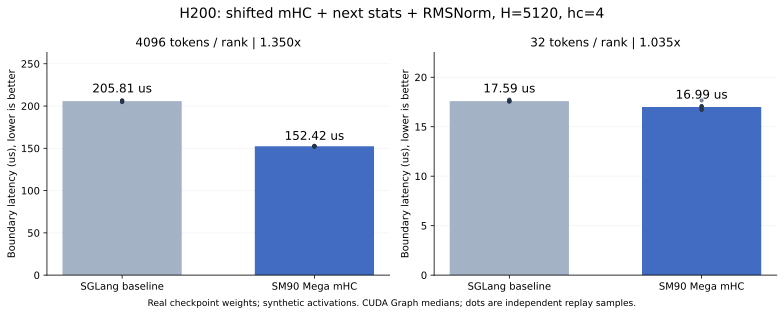
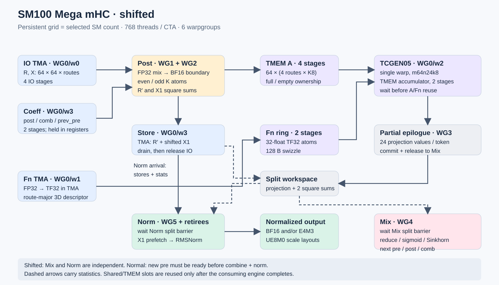
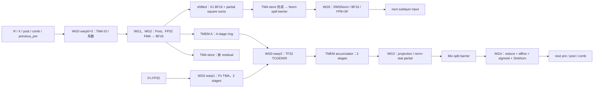
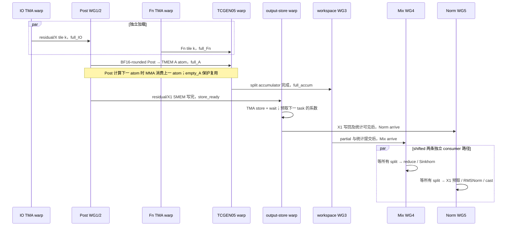
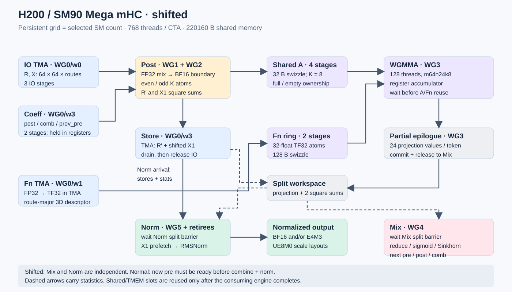
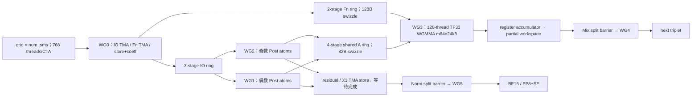
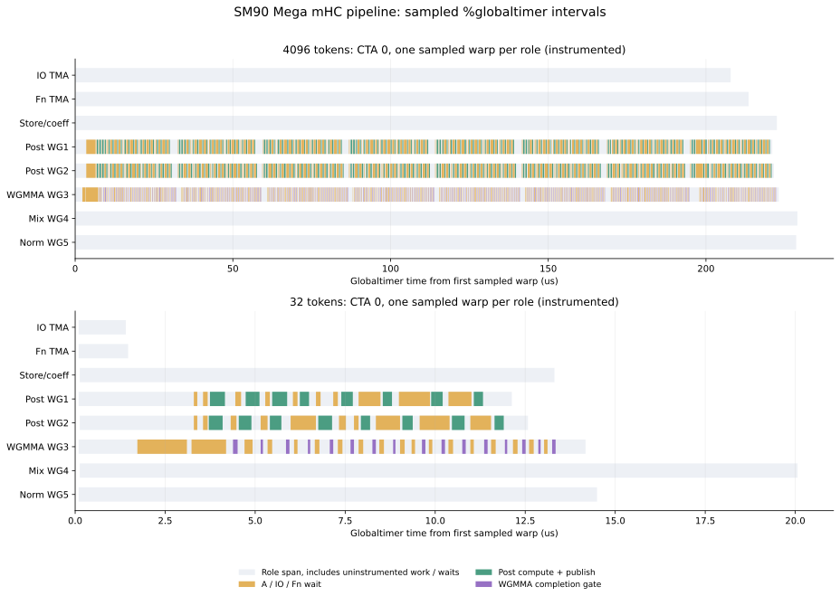

# SM90 Mega mHC：社区调查、流水设计与 H200 验证

调查日期：2026-11-18。开发基线 `4f9479c`（`codex/0.2.2-sm90-megamoe-pr473`），开发分支 `codex/sm90-megamhc`，实现 commit `3a7c6a1`。

已测 V1 在 H200 单卡、真实 V4.1-Flash mHC/Norm 权重和随机激活下，4096-token boundary 加速 1.350×，32-token 加速 1.035×。默认 kernel 已恢复为这份实测快照。双 outstanding atom 候选仅通过正确性回归，按用户要求停止性能复测并单独归档。

| token/rank | SGLang baseline (µs) | SM90 Mega mHC (µs) | 加速比 | latency 变化 |
|---:|---:|---:|---:|---:|
| 4096 | 205.81 | 152.42 | 1.350× | -25.94% |
| 32 | 17.59 | 16.99 | 1.035× | -3.37% |

计时包含 Mega mHC 的 active-barrier clear 和 kernel；不含 CPU 调用、模型 forward、MoE 或跨卡 collective。原始数据见 [证据归档](../artifacts/sm90-mega-mhc/README.md)，候选原理与恢复计划见 [双 outstanding atom 记录](experimental/sm90-mega-mhc-double-outstanding.md)。

## 社区工作与决策

检索 `deepseek-ai/DeepGEMM` 和 `sgl-project/DeepGEMM` 的 mHC PR、issue，并复查 `mhc in:title`、SM90/Hopper 组合。检索范围内未发现独立的 SM90 Mega mHC 实现。普通 HC prenorm、MegaMoE 和 SM120 请求不算 Mega mHC 移植；未公开的工作无法核实。

| 工作 | 核实状态 | 对本移植的意义 |
|---|---|---|
| [upstream #502](https://github.com/deepseek-ai/DeepGEMM/pull/502) | open，2026-11-11 更新 | Post atom 完全展开造成指令缓存压力，改为 unroll 2；作者 B200 4096-token 结果 99.85→93.53 µs，不能当作 H200 结果 |
| [SGL #141](https://github.com/sgl-project/DeepGEMM/pull/141) | merged | wave-aware split、长网格任务队列、轻量 barrier polling、Norm 分区；SM107 oversized SMEM 中保留 X1。后者需要 CUDA≥13.4、约 319 KB SMEM，不能直接搬到 H200 |
| [SGL #136](https://github.com/sgl-project/DeepGEMM/pull/136) | merged | 直接输出 FlashInfer 128×4 swizzled SF，减少格式转换；当前基线仅有 2D GEMM/routed/shared SF 接口 |
| [upstream #478](https://github.com/deepseek-ai/DeepGEMM/pull/478) | merged | `%gridid` 在 graph replay 中重复；社区改为 epoch。本地旧基线使用 launch 前清空 active barrier lines |
| [upstream issue #503](https://github.com/deepseek-ai/DeepGEMM/issues/503) | 已检索到的问题 | 同 capture stream 的不同 graph 若共享 barrier，跨 stream 并发 replay 会冲突。SM90 采用每次调用独立 barrier allocation |
| [SGL #143](https://github.com/sgl-project/DeepGEMM/pull/143) | merged | 双权重 HC prenorm 和 decode-sized BLOCK_M=128，属于解耦 stats 的优化；说明 decode 应保留与 MoE 重叠的能力 |
| [SGL #146](https://github.com/sgl-project/DeepGEMM/pull/146) | closed、未合并、draft | HC prenorm 的 TMA store 生命周期问题；本移植在 IO buffer 复用前明确等待 TMA store 完成 |

没有可直接迭代的社区 SM90 Mega mHC PR，因此在已有 SM90 MegaMoE 分支自行实现。保留 SM100 的主要融合和流水机制，针对 Hopper 更换 tensor core 和片上存储机制。

## 数值语义

每个 token 有四条 residual stream。`Fn` 为 FP32 `[24,4H]`，输出按 `[pre(4),post(4),comb(16)]` 排列。

1. `R'[j] = BF16(post[j]·X + Σ_i comb[i,j]·R[i])`，内部 FP32 FMA。
2. `projection = flatten(R') · Fnᵀ`；用 `R'` 的 RMS 缩放，affine 后 pre/post 做 sigmoid，comb 做行 softmax 和交替行列 Sinkhorn 归一化。
3. **Shifted / V4.1：** `X1 = BF16(Σ_j previous_pre[j]·R'[j])`。它依赖携带的旧 pre，不依赖第 2 步生成的新 pre，故 Norm 和新 Mix 可并行。
4. **Normal：** 用第 2 步的新 pre 构造 X1，因此必须等待 Mix。
5. RMSNorm 从 BF16 舍入后的 X1 计算平方和；可输出 BF16、E4M3，以及每 32 元素一个 UE8M0 scale（每 128 元素打包为 int32）。

不能删除两次 BF16 边界来换取性能。comb 的 `[input_route,output_route]` 方向、shifted pre 的跨 sublayer 语义也不能反转。

## SM100 总体架构

| 层级 | 本地 SM100 实现 |
|---|---|
| grid | `num_sms × 1 × 1`，persistent；一 CTA/SM |
| CTA | 768 threads = 24 warps = 6 warpgroup，`__launch_bounds__(768,1)` |
| tile | `BLOCK_M=64`、`BLOCK_N=24`、`BLOCK_K=64`；每条 route 的 TF32 K atom=8 |
| task | `(m_block,k_split)`，`task_idx=blockIdx.x+n·num_sms`；长短 split 按完整 K block 划分 |
| split | deterministic=16；默认至多 64，选择达到最短最长任务的最少 split |
| TMA | route-major residual，无需显式 transpose；Fn 采用 32-float swizzle atom；128B IO/Fn swizzle，comb 64B swizzle |
| rings | IO=4、Fn=2、A=4、accumulator=2、coefficient=2 |
| Post threads | 一 WG 内 lane 组共同拥有两 token rows 和一 column pair；两个 WG 交错处理 K atoms |
| Mix threads | 一 warp/token，lane 0–3 pre、4–7 post、8–23 comb；shuffle 完成归约和 4×4 Sinkhorn |
| Shifted Norm | 一 warp 处理 token pair × hidden partition；256 hidden/pack，8 BF16/lane；current/next 预取 |

### 算子内流水与关键依赖（非按比例时间图）

图中为 Shifted 路径。Normal 模式中 WG4/5 立即转为 Mix+Pre+Norm workers，其他 producer WG 退休后也加入同一任务队列；每 WG 使用独立 named barrier。Shifted 则由 WG5 先执行 Norm，退休的两个 Post WG 再加入。

主要优化：消除独立 Post→stats 的 residual 重读；在 Post 同时构造 X1 和两组平方和；TMA 原生布局与环形 buffer；系数寄存器驻留并在最终 store drain 窗口预取下一 task；A、accumulator 分离；Mix/Norm split barrier 分开；按角色 setmaxnreg；producer 退休后加入 Norm/Normal task queue；16B 向量 IO；双 token Norm 复用 weight；SF 直接输出消费者所需布局。

关键路径不是固定的一条：prefill 通常应检查 `IO→Post→A→MMA→Mix` 与 `Post→store→Norm` 的最长分支；decode 更容易受 launch、M tile 空行、split barrier、Norm partition 和低占用影响。这里只描述依赖，需用实测 trace 判断瓶颈。

## H200 适配与当前实现

| SM100 手段 | SM90 处理 |
|---|---|
| packed FP32 MUL/FMA | Hopper 映射为两路 `__fmul_rn/__fmaf_rn`，保留独立舍入；SM100 保留原生 packed 指令 |
| 单 warp TCGEN05，TMEM A/accumulator | WG3 全 128 threads 执行 WGMMA；A 存 shared，accumulator 在寄存器；没有 TMEM |
| 4-stage IO | 调为 3 stages，给 A ring 留出 SMEM；Hopper 上限 232448 bytes/CTA |
| UMMA async arrival | WGMMA commit/wait 明确保护 A/Fn 生命周期；full/empty barrier 保留 |
| release async reduction | SM90 使用普通 `red.release.gpu.global.add.u64` |
| Blackwell TMA store cache hint | 改用 SM90 TMA store 指令；保留 Norm 的向量加载与预取 |
| 两个模板 Post worker | 保留两 worker 和 atom unroll 2；避免无约束展开 |
| CUDA Graph barrier | 每次调用独立 allocation，launch 前只清 active lines；支持 graph replay 并发隔离 |
| SM107 oversized in-CTA Norm | 不直接移植：H200 SMEM 不够；后续可尝试较小 tile / split 和寄存器保留 X1，但必须证明无循环等待 |

当前路径保留 normal/shifted、BF16/FP8、GEMM/routed/shared SF。用于 V4.1 的主比较是 shifted BF16；FP8 输出保留 UE8M0 合约，不能直接假设它等同于旧 SM90 FP32 scale GEMM 接口。

H200 实际 launch：`grid=(132,1,1)`、`block=(768,1,1)`、dynamic SMEM=220160 B。4096 tokens 采用 64 m-blocks、16 splits、1024 producer tasks；32 tokens 采用 1 m-block、40 splits、40 producer tasks。寄存器预算为 WG0=32、两个 Post WG 各 136、WGMMA WG=48、Mix WG=32、Shifted Norm WG=96；按 128 threads/WG 合计 61440 个 32-bit registers。静态 SMEM 和寄存器限制使每 SM 最多驻留一 CTA，24/64 warps 的理论 occupancy 为 37.5%。

Post 的 thread mapping：每 warp 16 token rows，lane 四个一组，每 lane 拥有相隔 8 行的两组 row 和一个 column pair。WGMMA accumulator 的每 lane 12 个 FP32 对应两行各 6 个输出；三个 8-column group 合计 24 个 HC outputs。shared A 的 32B swizzle 以 byte-address bit 7 翻转 bit 4，因此 float K8 row 中的 bank group 使用 `((row >> 2) & 1)`，与 128B IO swizzle 的行位不同。

### 性能计划与预期

按机制估算，分离 baseline 的主激活流量约为 180 KiB/token，融合路径约 120 KiB/token（H=5120、BF16、忽略 cache/weight/partial），4096 tokens 约减少 240 MiB。这部分主激活流量的比值约 1.5；实际收益还取决于 Post 指令、WGMMA、buffer/barrier 和 cache 命中。

1. 首先确认所有数值边界、tail、normal/shifted、FP8 SF、graph replay 和并发 graph 正确。
2. 通过 `%globaltimer` 分解 Post wait/compute、WGMMA A/Fn wait 和 drain；profile 与无打点 latency 分开。
3. 若 WGMMA drain 串行成为关键路径，尝试延后一 atom 释放 A stage，保留两组 outstanding work；不得在未完成前覆盖 shared A/Fn。
4. 若 Post 占主导，比较共享 Post 指令路径、unroll 1/2 和 IO stages；预期针对被观测 stall 改善，避免预设固定百分比。
5. 比较 wave-aware split 和 grid 大小，尤其 32-token decode；小 batch 可能需要更小 M tile 或独立 decode 专用布局。
6. 长网格的动态 producer queue 和 relaxed/backoff barrier polling 可进一步移植；任务队列与保留 X1 的 buffer 必须避免 #141 描述的循环等待。
7. SGL #136 的 4D swizzled SF 是后续接口扩展项；本次 BF16 接入不依赖它。

## SGLang 接入方案

本地目标为 `../sglang`，已有 `kernels/ops/layernorm/mhc_mega.py::mhc_mega_boundary` 和 `models/deepseek_v4_mhc.py::_can_use_mega_mhc/_post_fusion`。

1. 安装或加载包含 SM90 dispatch 的 `deep_gemm`。先使用本项目独立开发 package，不覆盖 csy 环境已有 wheel。
2. `_can_use_mega_mhc` 增加显式 SM90 开关及能力判断，原有 SM100 行为单独保留；初期只在已验收的 H=5120、hc=4、shifted、非 CP、可融合 boundary 上启用。
3. 复用 `mhc_mega_boundary` 的返回值：`updated`、`HcNormed(normalized)`、下一组 stats。下一 sublayer 应跳过已完成的 combine/stats，仍保留正确 carried pre 状态。
4. decode 的当前 stats 可在 side stream 与 MoE 重叠；算子边界 A/B 不能证明融合后整层必然更快。decode 默认开关需基于 MoE 共跑测试和整层关键路径决定。
5. 保留 Engram、row selection、TP collective、CP/DP token 范围和不支持 layout 的 fallback。边界输入 x 必须已经完成原本所需的 collective；Mega mHC 本身没有跨 GPU 通信。
6. CUDA Graph 用相同 capture/replay stream 和跨 stream 并发回归验证；模型端验收再做端到端精度及吞吐测试。

## 测试与复现

`scripts/bench_sm90_megamhc.py`：真实 checkpoint mHC/Norm 权重 + 固定种子随机激活；调用当前 SGLang `post/mix_stats/combine`；decode 使用 stats side stream。两个分支都在 boundary 末 join。输出逐 tensor 精度、交替顺序 CUDA Graph latency 和原始 samples。这里只是单卡算子测试，不包括模型 forward、MoE 或跨卡 collective。

`tests/test_sm90_mega_mhc.py`：normal/shifted、M tails、H=4096/5120/7168、FP8-only、两种 SF 布局、deterministic、变输入并发 graph replay。

profile 的设备缓冲为 `[num_sms,24,4097,2] int64`，每 warp 一位 lane 写入 `(event+aux,%globaltimer)`；slot 0 记录尝试事件数，超过 4096 显式报告 dropped events。关闭开关时 trace 代码通过模板完全消除。Perfetto 文件中的 warp interval 累加值不是 kernel latency。

### 已完成验证与观察

- 默认 V1：4096/32 tokens 的真实权重精度、独立 FP32 参考以及 5 次变输入 graph replay 通过。两 shape 的五个输出最大 relative-L2 分别约 1.73e-5 / 2.90e-5（对 SGLang baseline）。
- 双 outstanding 候选：5 组回归通过，模式测试含 8 个组合；覆盖 FP8 与 SF、tails、one-hot swizzle、concurrent replay、deterministic。日志和候选 SHA256 单独归档。默认 V1 没有在修订后的整套回归上重跑，不能将候选日志写成 V1 日志。
- 共享 epilogue 的 SM100 BF16+FP8 目标编译通过，没有 SM100 GPU runtime 结果。
- profile：4096 tokens 1,448,128 个事件、32 tokens 29,056 个事件，均无丢弃。打点后观测总 span 约 230.14 / 20.19 µs，明显大于无打点 boundary 计时，不能直接替代 latency。
- 在首轮 instrumented trace 中，4096-token Mix 最晚完成约 230.14 µs，Norm 约 229.09 µs；32-token Mix 约 20.19 µs，Norm 约 14.56 µs。这里只比较该次带打点执行中的依赖顺序。

图为全网格 profile 的 CTA 0 片段，每个角色取一个 warp；灰色 span 包含未细分的计算与等待。它展示实际重叠，不代表所有 CTA 的完整关键路径。大 shape 跨 stream 并发与 MoE 共跑尚未验收，persistent 全网格等待还需要验证调度进展。

### 接入补丁与限制

[docs/sglang-sm90-mega-mhc.patch](sglang-sm90-mega-mhc.patch) 已对本地 SGLang `7c5b581` 通过 `git apply --check`，尚未修改 SGLang 工作区，也未做模型端集成验收。它为 SM90 prefill/decode 分别增加 opt-in 开关，检查 `mega_mhc.supported_architectures`，复用现有 boundary 返回协议。

补丁从 `ForwardBatch` 传递实际 decode/extend 状态；其他 forward mode 默认 fallback。decode 与 prefill 分别控制，单卡算子收益不能代替 stats/MoE overlap 的整层验收。

CP guard 当前来自静态 `cfg.cp_prefill`，会连带限制启用 CP 的服务中的 decode。下一阶段需把实际 forward mode、rank token range、CP reorder/contiguity 信息传到 boundary gate，再扩展 CP；不能仅删除 guard。collective/finalize、Engram 或 row selection seam 也需分别验收。

Hopper 资源限制参见 [NVIDIA Hopper Tuning Guide](https://docs.nvidia.com/cuda/hopper-tuning-guide/)，packed FP32 intrinsic 的架构要求参见 [CUDA Math API](https://docs.nvidia.com/cuda/cuda-math-api/cuda_math_api/group__CUDA__MATH__INTRINSIC__SINGLE.html)。

当前状态：按用户要求停止双 outstanding atom 性能测试并归档；默认保留已测 V1，后续计划见候选记录。
